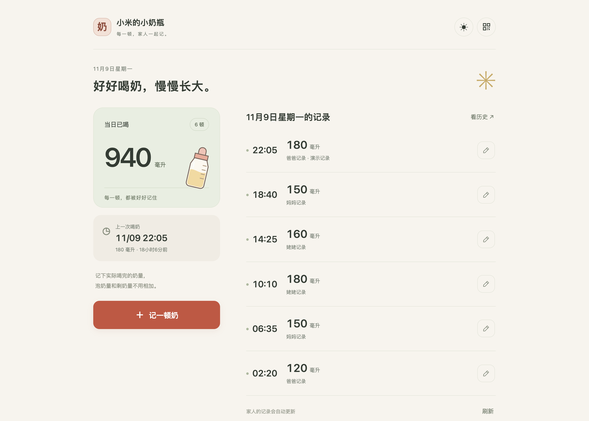
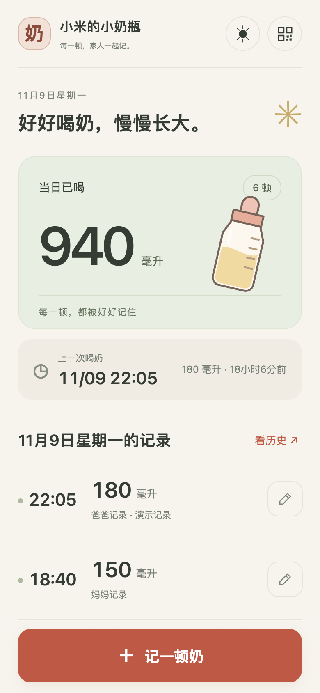
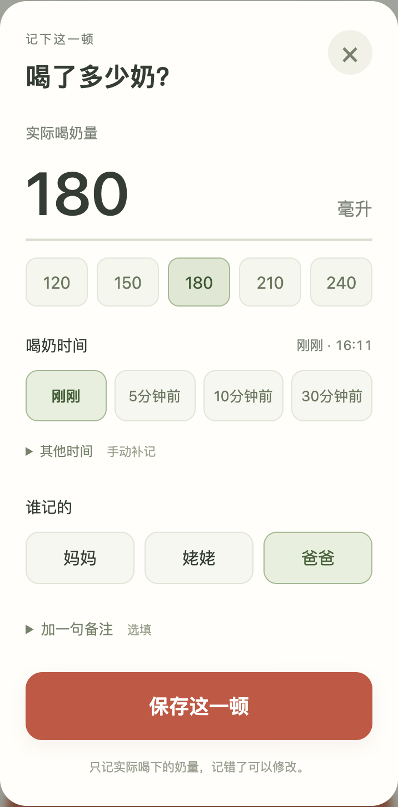
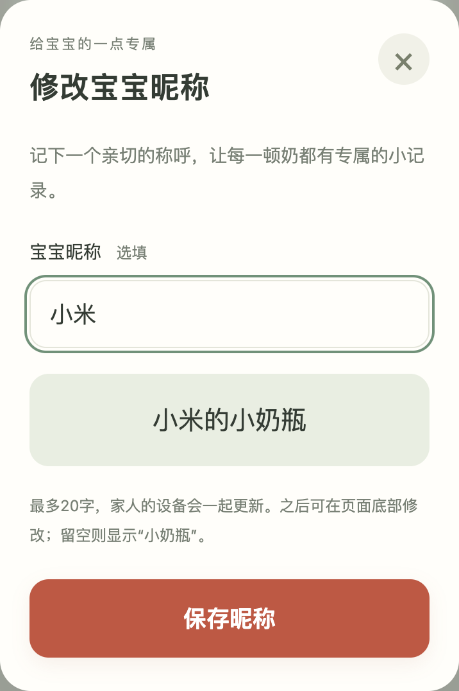
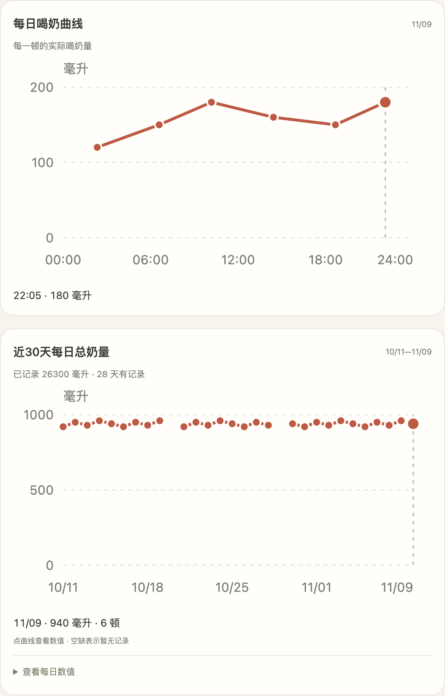

# 小奶瓶 · MilkLog

一个给家人一起用的轻量奶量记录页面。手机打开即可记录宝宝**实际喝下**的奶量，数据保存在自己电脑上的 SQLite 数据库中。

Python 后端 + 原生 HTML/CSS/JavaScript，无前端构建步骤，不依赖云服务或第三方网页资源。

当前版本：**0.1.0（早期版本）**，面向家庭局域网自部署。

## 界面预览

以下均为应用的**白天模式实际运行截图**，昵称“小米”和全部奶量记录均为虚构演示数据，不包含任何家庭的真实记录，也不包含访问密钥和家庭二维码。

### 电脑上，一眼看清每天的记录

左侧显示当日总奶量和上一次喝奶时间，右侧按时间列出每一顿。家人可以一起录入，记错后也能修改。



### 手机上，随手记下一顿

打开即可查看当天记录，底部按钮始终方便点按。录入时可选择常用奶量、快捷补记时间和记录人。

<table>
  <tr>
    <th>手机首页</th>
    <th>奶量录入</th>
  </tr>
  <tr>
    <td align="center" valign="top"></td>
    <td align="center" valign="top"></td>
  </tr>
</table>

### 用宝宝的昵称，拥有专属的小奶瓶

首次使用可以填写昵称，也可以跳过。填写“小米”后，页面会变成“小米的小奶瓶”；之后可随时修改，家人的设备共享同一个设置。

<p align="center"></p>

### 从每一顿，看到近30天的变化

每日曲线展示每顿实际喝下的奶量，近30天曲线展示每日总量。点按数据点可查看数值，没有记录的日期保留为空缺。

<p align="center"></p>

## 功能

- 记录、补记、修改每顿奶量、时间、记录人和备注。
- 当日总量、上次喝奶时间、历史日期查询。
- 每顿奶量曲线和近 30 天每日总量；没有记录的日期显示为空缺。
- 白天、夜间和跟随系统三种显示模式，适配手机和电脑。
- 家庭二维码分享；扫码后浏览器记住访问权限。
- 首次进入可设置宝宝昵称或跳过，之后在页面底部“修改昵称”修改；同一家庭的设备共享设置。
- 多人使用时每 20 秒刷新，保存时防重复提交、检查记录版本。
- 软删除、短时撤销、操作审计、CSV 导出和 SQLite 备份。

## 本机运行

需要 Python 3.11–3.14。后端仅使用标准库，二维码使用 `qrcode==8.2`。这些 Python 版本已在 macOS 通过后端测试；Windows 安装命令已提供，实机验证仍待完成。

先下载源码并解压，或克隆仓库，然后在项目根目录打开终端执行以下命令：

```sh
git clone https://github.com/xchen-zhao/milklog.git
cd milklog
```

macOS / Linux：

```sh
python3 -m venv .venv
source .venv/bin/activate
python -m pip install -r requirements.txt
python server.py --show-access-url
```

Windows PowerShell：

```powershell
py -3 -m venv .venv
.\.venv\Scripts\python.exe -m pip install -r requirements.txt
.\.venv\Scripts\python.exe server.py --show-access-url
```

打开终端打印的 `Private family access URL` 完成首次授权。只打开普通首页时会提示扫码。访问链接包含密钥，请勿放入截图、公开日志或 GitHub。

首次授权后会询问宝宝昵称，例如填写“小米”后显示“小米的小奶瓶”。可以跳过，或之后清空昵称，使用通用的“小奶瓶”。昵称最长20字，保存在本地 SQLite 数据库中，包含在完整备份里。其他已打开的家庭页面会在下次刷新时同步（通常不超过20秒）；未授权访客看不到昵称。

按 `Ctrl+C` 停止。首次启动自动创建 `data/config.json` 和 `data/milk.sqlite3`，不会生成任何示例喂奶记录。

## 家庭 Wi-Fi 共享

查出运行电脑的局域网 IPv4 地址，将下面的 `192.168.1.100` 换成自己的地址：

```sh
python server.py --host 0.0.0.0 --port 18766 --lan-url http://192.168.1.100:18766 --show-access-url
```

先在电脑打开终端里的私有访问链接，再点页面右上角二维码，让连着同一家庭 Wi-Fi 的手机扫码。电脑需保持开机；必要时仅允许家庭局域网通过防火墙访问该端口。

默认只监听 `127.0.0.1`。程序采用 HTTP 和一枚家庭共享密钥，适用于受信任的家庭网络；没有个人账号、分角色权限或面向公网的服务加固。获得家庭链接的人可以查看、修改、导出所有记录及备份。不要直接把这个服务暴露到公网，也不要将密钥链接提交到仓库。

## 录入方式

点“记一顿奶”，填实际喝下的毫升数，时间默认刚刚。可以快捷选择 5、10、30 分钟前，或展开“其他时间”补记。

键盘连续录入示例：`200` → 回车 → `1730` → 回车，表示在表单选定日期记录 17:30 喝下的 200 ml。记录人默认提供“妈妈、姥姥、爸爸”，设备会记住上次选择。

按北京时间（UTC+8）零点划分日期，暂不支持其他时区配置。奶量 1–1000 ml 是输入校验范围，不是喂养建议。

## 数据与恢复

所有运行数据位于 `--data` 指定目录，默认是项目下的 `data/`：

- `config.json`：家庭访问密钥。保留它可以继续使用原有家庭链接和二维码。
- `milk.sqlite3`：喂奶记录、软删除历史、操作审计和幂等请求记录。
- `backups/YYYY-MM-DD.sqlite3`：当天快照，每次成功修改后尝试刷新；下载备份时也会刷新快照。自动快照失败不会撤销已经保存的记录。

页面可导出全部有效记录的 CSV，或下载完整 SQLite 数据库。完整备份包含软删除和审计历史。备份仍在同一台电脑，建议定期下载到另一台设备妥善保存。

恢复步骤：

1. 停止服务，完整复制当前数据目录留作回退。
2. 用备份数据库替换 `milk.sqlite3`。
3. 仅在服务停止后移走旧的 `milk.sqlite3-wal`、`milk.sqlite3-shm`，避免旧事务文件干扰恢复。
4. 保留原 `config.json`，重新启动并检查记录。

## 开发与测试

```sh
python -m unittest -v test_server.py
python server.py --port 18767 --data ./dev-data --show-access-url
```

测试自动使用临时目录，不读写家庭正式数据。开发预览也请使用独立数据目录。GitHub Actions 的实际运行结果见仓库的 [Actions 页面](https://github.com/xchen-zhao/milklog/actions)。

可选的浏览器回归需要 Node.js 20 或更新版本，仅用于开发测试，运行应用不需要 Node.js：

```sh
npm ci
npx playwright install chromium
npm run test:ui
```

请在已安装 Python 依赖的环境中运行。测试启动独立服务并使用临时数据库，不连接家庭服务。可用 `MILKLOG_PYTHON` 指定 Python 可执行文件；可用 `MILKLOG_CHROME` 指定已有 Chrome 路径，替代下载 Chromium。

CI 配置覆盖 Windows/Linux 上的 Python 3.11–3.14 后端测试，以及 Linux 上的浏览器回归。本地验证结果与尚未执行的 CI 分别记录在 [发布前清单](RELEASE_CHECKLIST.md)。

记录人名称目前写在 `server.py`、`web/index.html` 和 `web/app.js` 中，修改时需保持一致。旧记录中的“家人”保留原值，编辑时应选择具体记录人。

## 当前限制

- 一个服务对应一个宝宝，不提供多宝宝切换。
- 记录人固定为“妈妈、姥姥、爸爸”，未提供页面配置。
- 日期统计固定北京时间（UTC+8）。
- 家庭成员共用访问密钥，权限相同；不支持个人账号和权限划分。
- 每日数据库快照不会自动清理，会持续占用磁盘。
- Windows 实机安装尚待验证；Windows/Linux 自动化测试以仓库 Actions 的实际结果为准。

## 开源范围

此目录是从家庭自用版本独立整理的待发布副本；不含家庭数据、访问密钥、家庭二维码、真实记录截图、设备部署信息及实验性语音代码。项目和页面统一使用“小奶瓶 · MilkLog”这一通用名称，不绑定任何孩子的姓名；家人私人称呼已改为通用称呼。项目目前只支持页面手动录入，不提供语音接入。

代码采用 [MIT License](LICENSE)，版权行使用“MilkLog contributors”。第三方依赖见 [THIRD_PARTY_NOTICES.md](THIRD_PARTY_NOTICES.md)，版本变化见 [CHANGELOG.md](CHANGELOG.md)。源码仓库：[xchen-zhao/milklog](https://github.com/xchen-zhao/milklog)。
